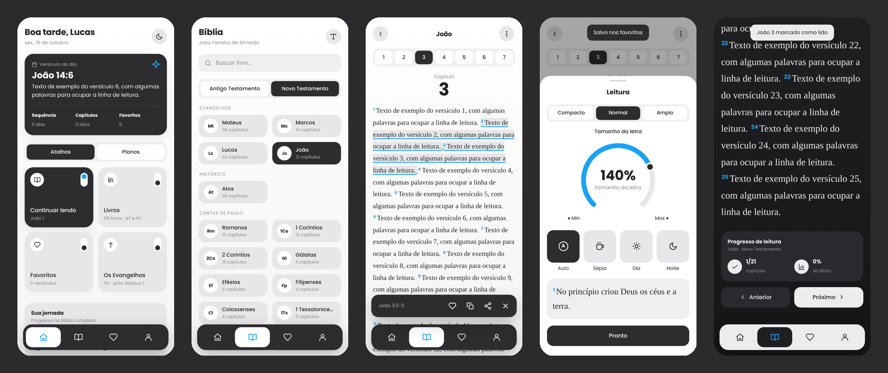

# Bíblia 📖

App de leitura da Bíblia — simples, amigável e bonito. Primeira versão (v0.1.0), feito como PWA em HTML, CSS e JavaScript puro, sem etapa de build.



O visual segue uma linguagem de cinzas suaves, cards em grafite e acento azul, com cantos bem arredondados e a fonte Poppins.

## Funcionalidades

- **Início** com saudação, *versículo do dia*, sequência de dias de leitura e atalhos (continuar lendo, livros, favoritos, plano ativo)
- **Planos de leitura**: Evangelhos, Salmos e Provérbios, Novo Testamento e Bíblia completa, com progresso
- **66 livros** organizados por Antigo/Novo Testamento e por grupo, com busca (ignora acentos) e seletor de capítulos
- **Leitor** com chips de capítulos, marcação automática de capítulo lido ao chegar ao fim, anterior/próximo
- **Versículos**: toque para selecionar um ou vários e favoritar, copiar ou compartilhar
- **Aparência**: controle circular do tamanho da letra, espaçamento entre linhas e temas Auto, Sépia, Dia e Noite
- **Favoritos** e **Perfil** com estatísticas
- Funciona offline depois de aberto (service worker + cache local dos capítulos já lidos)

Todo o progresso fica salvo no próprio aparelho (localStorage).

## Texto bíblico

Tradução **João Ferreira de Almeida** (domínio público), carregada da API gratuita [bible-api.com](https://bible-api.com).

## Como rodar

Qualquer servidor estático serve. Por exemplo:

```bash
python3 -m http.server 8080
# ou
npx serve .
```

Depois abra `http://localhost:8080` (de preferência no modo celular do DevTools). No celular, use "Adicionar à tela inicial" para instalar como app.

Para publicar de graça, ative o **GitHub Pages** no repositório (Settings → Pages → branch `main`, pasta `/`).

## Estrutura

```
index.html            casca do app (navegação, sheet, barra de ações)
css/styles.css        tema e componentes (variáveis para Dia/Noite/Sépia)
js/app.js             rotas, telas e interações
js/books.js           livros, versículos do dia e planos de leitura
js/store.js           estado persistido (progresso, favoritos, preferências)
js/api.js             busca e cache dos capítulos
js/icons.js           ícones SVG
sw.js                 service worker (offline)
manifest.webmanifest  instalação como PWA
```

## Próximos passos

- Busca por palavras no texto
- Anotações e marca-texto com cores
- Outras traduções e modo totalmente offline
- Lembrete diário de leitura
